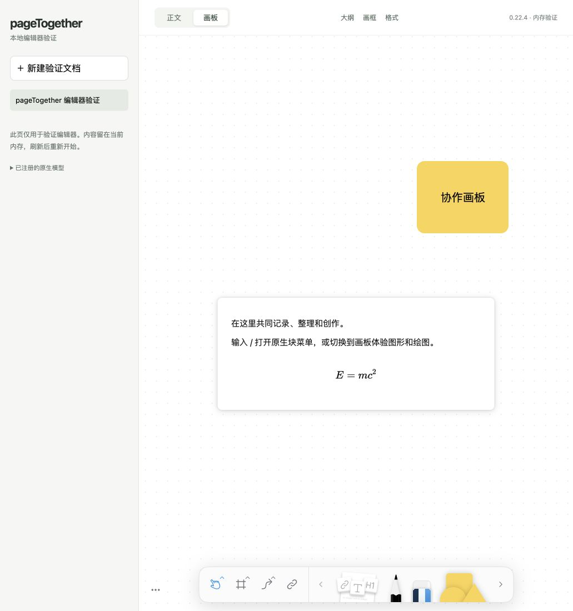

# pageTogether

给自己和朋友的共享文档与画板空间。

Invite-only documents and whiteboards for friends, built with BlockSuite and Yjs. In development.

pageTogether 希望让受邀成员在浏览器里共同记录、整理和创作。文档与画板共享同一套内容，进入空间无需邮箱注册。

## 当前状态

项目处于编辑器接入验证阶段。当前代码提供 BlockSuite 原生正文、画板、多文档与引用跳转，以及大纲、画框和格式面板。中文输入、撤销重做、基础表格、公式与图形文字已有真实浏览器验证。

**当前工作区仅在内存中运行，刷新后内容会重置。** 邀请、成员权限、服务端多人同步、可靠保存和恢复尚未实现。云端部署尚未开始，后续目标为 ECS，详见 [部署状态](AIREADME/DEPLOYMENT.md)。



上图为真实编辑器验证页，使用合成内容。完整原生能力清单、已验证项目与待验收范围见 [编辑器能力清单](AIREADME/EDITOR_CAPABILITIES.md)。

## 产品方向

以下为已确认的产品目标，尚未全部实现：

- 通过邀请进入同一个共享空间，填写昵称参与，无需邮箱注册。
- 在原生正文与画板之间切换，共同编辑空间内的文档。
- 完整保留选定 BlockSuite 版本的原生编辑能力，并逐项验收。
- 采用空间级管理、编辑、查看三档权限；整篇文档仅管理者可删除和恢复，服务端负责鉴权、撤权、附件与资源限制。
- 支持已缓存文档的离线编辑，正常重连自动合并，异常时保留离线稿；实现持久化和可验证的备份恢复，所有者使用离线恢复码恢复访问。

初期按最多 10 人同时在线、单个附件 50 MB 设计与验证。具体需求和验收标准见 [PRD](AIREADME/PRD.md)。

## 本地开发

使用 Node.js 22，版本至少为 22.12.0。在仓库根目录运行：

```sh
npm ci --ignore-scripts
npm run dev
```

打开终端输出的本地地址。开发与预览服务仅监听 `127.0.0.1`，按 `Ctrl+C` 停止。

| 命令 | 用途 |
|---|---|
| `npm run check` | 检查宿主代码与上游发布声明的类型兼容性 |
| `npm run build` | 类型检查、构建静态产物并生成第三方许可清单 |
| `npm run preview` | 在本机预览构建产物 |

当前基线固定为 BlockSuite 0.22.4、Yjs 13.6.33，宿主使用 TypeScript、Lit 与 Vite。`src/lab` 中的 `TestWorkspace` 仅用于编辑器验证。生产文档、网络协同和存储接口将独立实现，技术边界见 [ARCHITECTURE](AIREADME/ARCHITECTURE.md)。

## 文档

- [产品需求与验收标准](AIREADME/PRD.md)
- [编辑器完整能力与验证记录](AIREADME/EDITOR_CAPABILITIES.md)
- [下一步计划](AIREADME/ROADMAP.md)
- [项目文档索引](AIREADME/INDEX.md)
- [开发约定](AGENTS.md)

## 上游与许可

- [BlockSuite](https://github.com/toeverything/blocksuite/tree/v0.22.4) 提供原生编辑器与文档模型。
- [Yjs](https://github.com/yjs/yjs) 提供 CRDT 数据结构。

项目自主代码采用 [MIT](LICENSE)。上游与第三方组件保留各自许可，具体声明见 [THIRD_PARTY_NOTICES](THIRD_PARTY_NOTICES.md)。

`npm run build` 会生成 `dist/THIRD_PARTY_LICENSES.txt`，分发构建产物时一并保留。
